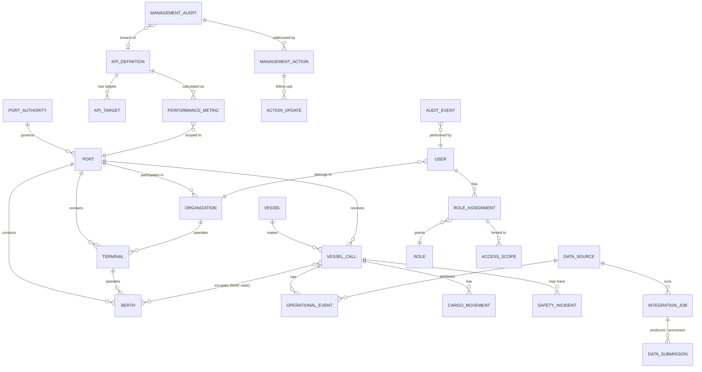

# PORTIX — Canonical Data Model Proposal

Status: **proposal**. No database has been created or migrated. The model evolves the current TypeScript types (`src/features/voms/types.ts`, `org.ts`) so that existing demo logic maps onto it.

---

## 1. Design goals
1. **Multi-port and multi-tenant from day one.** Every business row carries `port_id`; rows owned by an organization also carry `organization_id`.
2. **Source-attributed facts.** Operational facts record which system, record and ingestion job produced them.
3. **Snapshots for consistency.** KPI values are calculated by one engine from versioned definitions and stored as period snapshots, so the dashboard, reports and AI all quote the same number.
4. **History without mutation.** Facts are corrected by new versions (`valid_from` / `superseded_by`), never by in-place overwrite. This is the BRD principle "original and corrected value retained".
5. **Commodity-safe units.** Quantities always carry a unit, and aggregation never crosses units.

---

## 2. Entity overview

---

## 3. Entities

Attributes are abbreviated; every table also has `id` (UUID), `port_id`, `created_at`, `created_by`, `updated_at`.

### Reference and organization
| Entity | Key attributes | Authoritative owner | Notes / current equivalent |
|---|---|---|---|
| **PortAuthority** | name, country, timezone | PORTIX admin | — (new) |
| **Port** | authority_id, code (UN/LOCODE, e.g. PHSFS — **TBC**), name, timezone, currency, branding | PORTIX admin | Hard-coded "Port of Subic Bay" today |
| **Organization** | type (authority, terminal_operator, shipping_agent, service_provider, agency), name, data_sharing_flags | Port Authority | `org.ts#orgs` |
| **Terminal** | organization_id, name, cargo_domains[], contract_ref | Port Authority | `org.ts#units` (U-TA/TB/TC) |
| **Berth** | terminal_id, code, max_loa, max_draft, accepts[], status, valid_from/to | Port Authority (facility register) | `seed.ts#seedBerths`; the 15 placeholders must be replaced by the SBMA register |
| **Vessel** | imo (validated), mmsi, name, type, flag, loa, beam, draft, gt, dwt | Source: PMIS/VTMS; reference data | `types.ts#Vessel` |

### Operational facts (ingested, read model)
| Entity | Key attributes | System of record | Notes |
|---|---|---|---|
| **VesselCall** | vessel_id, agent_org_id, call_ref (source), portix_call_id, purpose, status (derived), voyage_in/out | **PMIS** (port call) | `types.ts#VesselCall`; status stays derived from events (`calc.ts#callStatus`) |
| **BerthVisit** | vessel_call_id, berth_id, all_fast_at, last_line_at, shifting_seq | VTMS / PMIS | Replaces the single `berthId`; needed for shifting and occupancy |
| **OperationalEvent** | vessel_call_id, type (ETA, ATA, PILOT_ON, FIRST_LINE, ALL_FAST, OPS_START, OPS_END, LAST_LINE, ATD, ETD…), event_time, time_type (estimated/requested/planned/actual — DCSA pattern), source fields, verification_status, superseded_by | VTMS (actuals), PMIS (estimates), TOS (ops start/end) | `types.ts#EventRecord` — add `time_type` and source fields |
| **CargoMovement** | vessel_call_id, terminal_id, commodity_code, cargo_category, direction, unit (TEU/MOVES/MT/KL/UNIT), quantity, period_start/end, quantity_type (declared/planned/actual/final), dangerous_goods | TOS (actual), PMIS/agent (declared) | `CargoLine` + `Production` merged with `quantity_type` |
| **Delay** | vessel_call_id, category_code, start, end, attributed_to | TOS / Port Control | `types.ts#Delay`; taxonomy **TBC** |
| **SafetyIncident** | vessel_call_id?, terminal_id?, type, severity, classification (Restricted), status, corrective_actions | Harbor Master | `types.ts#Incident` |

### Integration and data quality
| Entity | Key attributes | Notes |
|---|---|---|
| **DataSource** | organization_id, system_type (TOS, VTMS, PMIS, FILE, MANUAL), channel (API, SFTP, UPLOAD, FORM), contract_version, authority_for[] (attributes this source is authoritative for), freshness_sla | `types.ts#Connector` (partly) |
| **IntegrationJob** | data_source_id, started_at, finished_at, status, records_in/ok/rejected/held, error_summary, raw_object_uri, checksum | Today only implied by `Connector.log` |
| **DataSubmission** | data_source_id, template_id/version, report_date, file_uri, hash, status (review/submitted/approved/rejected), fields[] (value, confidence, citation, original), validation[], anomalies[], submitted_by, approved_by | `types.ts#Submission` — carries over almost 1:1 |
| **ReconciliationException** | entity_ref, attribute, values_by_source, resolution, resolved_by | New (BRD §19.7) |

### Performance and intelligence
| Entity | Key attributes | Notes |
|---|---|---|
| **KpiDefinition** | code (e.g. KPI-001), name, description, formula_ref, unit, direction (higher/lower better), aggregation (sum, avg, p90, ratio), grain (call, berth, terminal, port), frequency, owner_role, data_sources[], version, status | New; content from BRD §4 |
| **KpiTarget** | kpi_id, scope (port / terminal / berth), period (month / quarter / year), target_value, amber_threshold, red_threshold, rationale, approved_by, valid_from | New; four-eyes approval |
| **PerformanceMetric** (snapshot) | kpi_id, kpi_version, scope_type, scope_id, period_start/end, value, numerator, denominator, sample_size, data_completeness, calculated_at, input_watermark | New; immutable; recalculation creates a new row with `revision` |
| **ManagementAlert** | rule_id?, kpi_id?, category, severity, scope, evidence (metric ids / record ids), owner_role, status, ack/resolution fields, escalation_level | `types.ts#Alert` + rule and escalation |
| **AlertRule** | kpi_id or condition type, threshold, window, severity, escalation_policy | New |
| **ManagementAction** | title, issue, origin (alert_id / kpi_id / manual / ai_insight_id), recommended_action, owner_user_id, owner_org_id, priority, due_date, status (proposed, approved, in_progress, blocked, done, cancelled), baseline_metric_id, outcome_metric_id, outcome_assessment | **New — key differentiator** |
| **ActionUpdate** | action_id, author, note, status_change, attachments | New |
| **AiInsight** | scope, period, facts[] (metric/record refs), interpretation, proposed_actions[], model/version or "rule-based", confidence, generated_at | Structure for "verified facts / inferred explanation / proposed action" |

### Identity, access and audit
| Entity | Key attributes | Notes |
|---|---|---|
| **User** | organization_id, idp_subject, name, email, status | Demo `Session` today |
| **Role** | code (executive, pa_manager, terminal_manager, data_steward/submission_coordinator, integration_admin, auditor, + BRD operational roles), permissions[] | `roles.ts` |
| **RoleAssignment** | user_id, role_id, perspective, valid_from/to, granted_by | — |
| **AccessScope** | role_assignment_id, scope_type (port, terminal, organization, unit), scope_id | `Session.scopeUnitIds` |
| **AuditEvent** | actor, action, entity_type/id, before, after, scope, ip, at | Append-only; `VesselCall.audit` today is per-entity |

---

## 4. Data ownership and authority

| Data | Authoritative source | PORTIX role |
|---|---|---|
| Vessel movements (actual times) | VTMS | Read, reconcile, analyse |
| Port call administration, ETA notices, services, permits, billing | PMIS | Read; billing out of scope |
| Cargo handled, crane and berth productivity | TOS (each terminal) | Read; benchmark |
| Berth register, terminal boundaries | SBMA facility register | Reference data (admin-maintained) |
| Daily reports where no feed exists | Submitting organization | Intake, validate, approve |
| KPI definitions, targets, alerts, actions | **PORTIX (Port Authority)** | **System of record** |
| Incidents | Harbor Master (or SBMA safety system, if one exists — **TBC**) | Record if no source system; otherwise read |

---

## 5. KPI calculation consistency
- One KPI engine module with pure functions per `formula_ref`, taken from `calc.ts` (turnaround, waiting, berth occupancy, productivity) and extended. The same module runs in the backend jobs and, in demo mode, in the browser.
- Snapshots are stored with `kpi_version` and an `input_watermark` (the latest ingested record time). A late record triggers recalculation of affected periods and a new `revision`.
- Every KPI value exposes `data_completeness` (for example, "92% of calls have both ATA and ATD"). The UI greys values below an agreed threshold.

## 6. Multi-port expansion
- `port_id` on every business table, plus row-level security policies that combine `port_id` and `organization_id`.
- Code lists (vessel types, commodities, delay categories) are global with per-port overrides.
- Branding, time zone and KPI selection are configured per port.

## 7. Migration from the current demo
| Current (TypeScript) | Target |
|---|---|
| `VesselCall.events` (map) | `OperationalEvent` rows with `time_type` and source fields |
| `VesselCall.cargo` + `production` | `CargoMovement` (`quantity_type` declared / actual / final) |
| `VesselCall.berthId` | `BerthVisit` |
| `Submission`, `ExtractedField` | `DataSubmission` (+ fields JSON) |
| `Connector` | `DataSource` + `IntegrationJob` |
| `DailyStat` | `PerformanceMetric` at day grain |
| `Alert` | `ManagementAlert` (+ `AlertRule`) |
| `Session`, `roles.ts` matrix | `User`, `Role`, `RoleAssignment`, `AccessScope` |
| *(none)* | `KpiDefinition`, `KpiTarget`, `ManagementAction`, `ActionUpdate`, `AiInsight`, `Port`, `PortAuthority`, `ReconciliationException` |

For the P1 demo, these types are introduced in TypeScript and seeded synthetically. A database is created only in P2.
