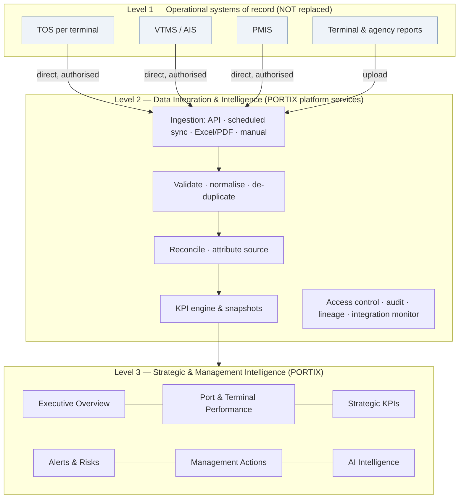

# PORTIX — Target Architecture

This document covers the target architecture (brief Phase A context), the integration strategy (Phase E) and security and governance (Phase F). The data model is in `PORTIX_DATA_MODEL_PROPOSAL.md`.

Status of this document: **proposal for review**. Nothing here has been built. Technology choices marked **[DECISION]** need product-owner approval.

---

## 1. Positioning in the port landscape



Principles:
- **Read from sources, do not operate them.** PORTIX never sends commands to TOS, VTMS or PMIS.
- **Direct connections.** Each source system connects directly to PORTIX under its own agreement; PMIS is never a mandatory relay for TOS or VTMS data.
- **Manual and file submission are first-class fallbacks** for sources without integration access. They are labelled, validated and reconciled exactly like API data.

---

## 2. Logical architecture

| Layer | Responsibility | Proposed components |
|---|---|---|
| Presentation | Executive and management UI, mobile views | Existing React 19 + TanStack Router + shadcn/ui SPA (rebranded) |
| API gateway / BFF | Authentication, session, tenancy context, rate limiting | Backend-for-frontend exposing REST (or tRPC) endpoints |
| Domain services | Vessel calls (read model), terminals, KPIs, alerts, actions, submissions, users and scopes | Modular monolith (one deployable, clear module boundaries) |
| Intelligence | KPI engine, snapshotting, alert-rule evaluation, anomaly detection, AI gateway | Scheduled jobs and on-demand calculation, sharing the same KPI definitions |
| Integration | Connectors, file intake, staging, validation, reconciliation, integration-job tracking | Worker processes with a durable job queue |
| Data | Operational read store, history and snapshots, raw landing zone, audit log | PostgreSQL (row-level security) + object storage for raw files |
| Platform | IdP integration, secrets, observability, backup | OIDC/SAML IdP, secrets vault, logs, metrics, traces |

**[DECISION] Recommended stack** — TypeScript end-to-end:
- **Backend:** Node.js with NestJS or Fastify.
- **Data and jobs:** PostgreSQL 16 with row-level security, a job queue (pg-boss or BullMQ), and S3-compatible object storage.
- **Why TypeScript:** domain types, KPI formulas and validation rules already written in TypeScript (`calc.ts`, `submissions.ts#check`, `types.ts`) can be shared between client and server without rewriting.
- **Hosting:** to be decided by SBMA policy (government cloud, Philippine region, or on-premises). Nothing in the design depends on a specific cloud vendor.

**Modular monolith first.** Separate microservices are not justified before real load and team size require them.

---

## 3. Front-end target structure (evolution of the current repo)

```
src/
├─ app/                    shell, providers, router (existing components/layout, context)
├─ design-system/          components/ui + domain presentation components (StatTile, charts…)
├─ modules/
│  ├─ executive/           Executive Overview
│  ├─ performance/         Port Performance, KPI detail, drill-down
│  ├─ vessels/             Vessel & Berth Intelligence (reuses vessel-calls, call-detail, berths)
│  ├─ terminals/           Terminal Intelligence & benchmarking (reuses cargo, trend-charts)
│  ├─ kpis/                KPI registry & targets
│  ├─ alerts/              Alerts & Risks (reuses alerts-panel, alerts page)
│  ├─ actions/             Management Action Tracker (new)
│  ├─ ai/                  AI Intelligence (reuses ai-panel)
│  ├─ integration/         Data Integration: submissions + API monitor (reuses existing pages)
│  └─ admin/               Administration (reuses access page)
├─ data/
│  ├─ ports.ts             interfaces: VesselCallRepo, KpiRepo, ActionRepo, …
│  ├─ mock/                current Zustand store + seed, behind the interfaces (demo mode)
│  └─ api/                 HTTP adapters (production mode)
└─ domain/                 shared types, KPI formulas, validation (shared with backend)
```

Key refactor: **put a repository interface between pages and the store.** Pages call hooks such as `useVesselCalls(filter)` and `useKpi(kpiId, period)`. A `DATA_MODE=mock|api` flag selects the adapter. This preserves the existing demo (backward compatibility) while enabling a real backend incrementally.

---

## 4. Integration strategy (Phase E)

### 4.1 Ingestion patterns

| Pattern | Typical source | Data contract | Validation | Error handling | Duplicates / idempotency | Sync status and freshness | Security |
|---|---|---|---|---|---|---|---|
| **Authorised API (pull)** | TOS, VTMS/AIS, PMIS | Versioned JSON schema per message type (vessel call, movement event, cargo move summary) | Schema, code lists, units, time-zone, referential (vessel, berth) | Retry with back-off; dead-letter after N attempts; mapping errors held, not dropped | Source record key + version (`source_system`, `source_id`, `source_updated_at`); upsert keyed on them | Per-connector last success, lag and record counts; freshness SLA per data type | mTLS or OAuth2 client credentials; credentials in vault; IP allow-list |
| **Scheduled synchronisation (batch)** | Systems that only allow nightly extracts (SFTP/CSV) | Agreed file layout per source, with column dictionary and checksum | As above plus row counts against the control total | Partial-file quarantine; job marked *failed* with a reason | File hash + row key; re-running a file is a no-op | Job history, expected-by time, *missing file* alert | SFTP keys rotated; files encrypted at rest |
| **Excel upload** | Terminal / agency daily reports | Template catalogue (existing `submissions.ts#templates`) with version | Existing rules (`check()`): required fields, numeric, IMO check digit, call-ID exists, anomaly vs typical, cross-field sums | Coordinator correction with history; return-to-submitter | Hash of file + (unit, report type, report date) uniqueness; resubmission creates a new version | Submission status; *missing / overdue submission* alert | Malware scan; size and type limits; virus-safe parser |
| **PDF report** | Scanned or digital reports | Same templates; extraction proposes fields with confidence and citation | Same as Excel plus a confidence threshold that forces human review | Low-confidence fields block submission until confirmed | Same as Excel | Same as Excel | Document service isolated; no data leaves the approved region |
| **Structured manual submission** | Fallback when no system or file exists | Form = contract | Same server-side rules | Inline validation | Natural key per form | Flagged *manual* everywhere it appears | Role and scope checked server-side; four-eyes approval |
| **Event-driven (future)** | Sources able to push (webhooks, message bus) | AsyncAPI-described events | Same as API | Same as API, plus out-of-order handling by event time | Event ID de-duplication window | Consumer lag | Signed payloads |

### 4.2 Common pipeline

```
receive → land raw (immutable, hashed) → identify source & contract version → parse/extract
→ validate (schema, rules) → normalise (units, codes, UTC + local time) → de-duplicate (idempotent upsert)
→ reconcile across sources → publish to read model → recompute affected KPI snapshots → evaluate alert rules
```

Every published record carries `source_system`, `source_record_id`, `ingestion_job_id`, `received_at`, `valid_from`, `confidence` (for extraction) and `verification_status`.

### 4.3 Reconciliation rules (extends BRD §19.7)
- **No silent overwrite.** When two sources disagree (for example, ATA from VTMS vs PMIS), both values are kept, a reconciliation exception is raised, and the configured **authoritative source per attribute** wins in KPIs.
- **Proposed default authority** **[ASSUMPTION]**: VTMS for actual movement times, PMIS for port-call administration (ETA notices, agent, services), TOS for cargo and berth productivity, and Excel/PDF only where no system feed exists.
- **Late data** triggers recomputation of affected KPI snapshots, with a revision note.

### 4.4 Operating with limited access
The design assumes some terminals will **not** grant API access initially. Each terminal can start on Excel/PDF submission (already demonstrated) and migrate to API later without changing KPIs, because both paths land in the same canonical records. **No public ICTSI, SBMA or Philippine-government API is assumed to exist.**

---

## 5. Security and governance (Phase F)

| Control | Design |
|---|---|
| Identity | Federated SSO (OIDC/SAML) with SBMA's IdP; external organizations through their own IdP or invited accounts with MFA. Roles and scopes come from the IdP and PORTIX assignments, **never from self-selection** (the current demo login is demo-only). |
| Authorization | Role × perspective × scope model (evolved from `roles.ts`), evaluated **server-side** on every request; database row-level security on `organization_id` / `terminal_id` as a second line of defence. |
| Organization isolation | Terminal data is visible to the owning terminal and to Port Authority roles. Peer terminals see anonymised aggregates only unless a data-sharing agreement flag permits otherwise. |
| Port Authority consolidated view | Port-wide scope for designated Port Authority roles only, and audited. |
| Least privilege | Default-deny policies; admin roles cannot approve operational or KPI-target changes (segregation of duties already modelled in `roles.ts`). |
| Human approval | Four-eyes approval for KPI target changes, submission approval, reopening a closed record, connector credential changes and AI-recommended actions before assignment. |
| Audit | Append-only audit log (who, what, when, before/after, source IP, scope), stored separately; application roles cannot update or delete it. |
| Data classification | Public / Internal / Confidential-Commercial (terminal performance) / Restricted (security incidents, personal data). Labels drive access, export and AI eligibility. |
| Credentials | Integration secrets in a vault, rotated, never in the repository or the browser. |
| Retention | Raw files and audit logs are kept per SBMA records policy **[ASSUMPTION: periods TBC]**; snapshots are kept long-term for trend analysis. |
| AI boundaries | The AI gateway receives only data the requesting user may see (same policy engine), logs prompts and responses, uses no training on customer data, and keeps every source citation. |
| Exports | Exports are watermarked with user and time, logged, and blocked for Restricted data. |
| Transport and storage | TLS 1.2+ everywhere; encryption at rest; backups encrypted and tested. |

---

## 6. Non-functional targets **[ASSUMPTION — to validate with SBMA]**

| Area | Target |
|---|---|
| Availability (management UI) | 99.5% business hours |
| Dashboard load | p95 < 2.5 s on 4G for executive overview |
| Data freshness | API sources ≤ 15 min; daily files by 09:00 local |
| Scale (initial) | 1 port, ≤ 10 organizations, ≤ 300 users, ≤ 50k vessel-call events/year |
| Accessibility | WCAG 2.2 AA |
| Localisation | English UI; Philippine time zone (UTC+08:00) display; ISO timestamps stored in UTC |
